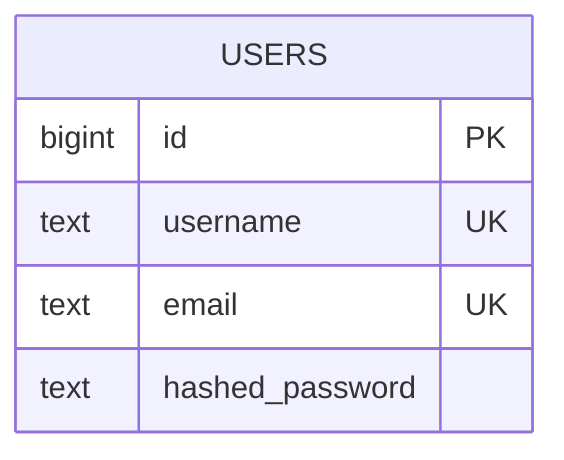
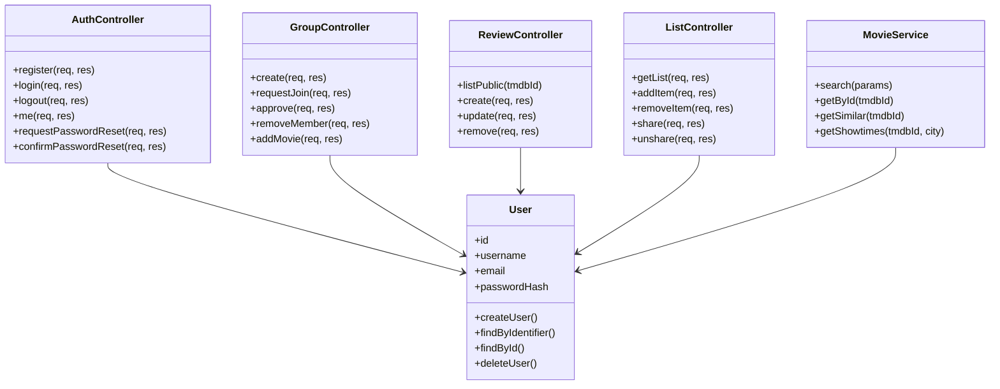

# Tekninen määrittely: Elokuvaharrastajien yhteisöpalvelu

**Versio:** 0.3 (luonnos)
**Päivämäärä:** 25.11.2026
**Laatija:** Projektiryhmä SG 8
**Tila:** Luonnos. Perustuu vaatimusmäärittelyyn 0.1 (29.10.2026) ja projektin nykyiseen lähdekoodiin.


---

## 1. Johdanto

Tämä on tekninen määrittely.

## 2. Suunnittelun lähtökohdat ja rajaus

### 2.1 Lähtötiedot

- Vaatimusmäärittely 0.1: roolit, käyttötilanteet, FR/NFR-vaatimukset ja Prioriteetit.
- Asiakkaan linjaukset 26.10. ja QA-tilaisuus 28.–29.10.
- Projektin runko: React 19 + Vite -frontend, Express 5 -backend, PostgreSQL 18, Docker Compose, Azure-julkaisu GitHub Actionsilla.


---

## 3. Teknologiavalinnat

| Osa-alue | Teknologia | Versio |
| --- | --- | --- |
| Frontend | React | 19.x |
| Build | Vite | 7.x |
| Reititys | React Router | 7.x |
| UI-tyyli | Bootstrap + Bootstrap Icons | 5.3.x |
| Backend | Node.js + Express | 24.x / 5.x |
| Tietokanta | PostgreSQL | 18.x |
| Tietokanta-ajuri | `pg` | 8.x |
| Autentikointi | JWT evästeessä + argon2 | jsonwebtoken 9.x, argon2 0.45.x |
| Validointi | `validator` | 13.x |
| HTTP-asiakas | `axios` | 1.x |
| Testaus | Vitest + Supertest + Playwright | 5.x / 7.x / 1.65.x |
| Kontitus | Docker + Docker Compose | - |
| CI/CD | GitHub Actions | - |
| Hosting | Azure Web App | - |


---

## 4. Arkkitehtisuunnittelu

### 4.1 Arkkitehtuurimalli ja kerrokset


**Kerrosten vastuut:**

| Kerros | Vastuu | Sijainti koodissa |
| --- | --- | --- |
| View | Käyttöliittymä, reititys, lomakkeet, tilanhallinta | `src/` |
| Controller | Pyynnön validointi, liiketoimintalogiikka, vastauksen muodostus | `api/controllers/` |
| Model | Tietokantakyselyt ja rivien muunnos | `api/models/` |
| Route | Polut ja HTTP-metodit | `api/routes/` |
| Middleware | Autentikointi, CSRF, virheenkäsittely | `api/middleware/` |

### 4.2 ER-Kaaviot

WIP


### 4.3 Moduulit ja vastuut

| Moduuli | Vastuu | Keskeiset vaatimukset |
| --- | --- | --- |
| Auth | Rekisteröinti, kirjautuminen, uloskirjautuminen, istunto, salasanan palautus, tilin poisto, 2FA | FR-13–FR-18, NFR-04, NFR-12 |
| Movie | Haku, suodatus, elokuvan tiedot, samankaltaiset elokuvat, näytösajat | FR-01–FR-12, NFR-01, NFR-11 |
| Group | Ryhmien luonti, liittymispyynnöt, jäsenhallinta, ryhmän elokuvat, chat | FR-20–FR-32 |
| Review | Tähtiarvostelut, kommentit, näkyvyys, muokkaus | FR-33–FR-42 |
| List | Toive- ja suosikkilistat, jakaminen | FR-43–FR-46 |
| Recommendation | Suositukset katseluhistorian perusteella | FR-47–FR-48 |
| Shared | Autentikointi, CSRF, virheenkäsittely, validointi | NFR-04–NFR-07 |

### 4.4 Moduulien väliset rajapinnat ja riippuvuudet

- Frontend kutsuu backendia vain `src/api.js`-asiakkaan kautta. Suoraa `fetch`-kutsua komponenteissa ei käytetä.
- Backendin moduulit eivät kutsu toisiaan suoraan, vaan jakavat `models`-kerroksen ja middlewaret.
- Ulkoiset riippuvuudet on eristetty omiin palveluihinsa:
  - TMDB-asiakas (NFR-11)
  - Näytösaikojen tarjoaja (FR-10, FR-11)
  - Sähköpostipalvelu (FR-15)

---

## 5. Tietokantasuunnittelu

### 5.1 Periaatteet

- Relaatiomalli, PostgreSQL.
- Salasanoja ei koskaan tallenneta selkokielisenä (NFR-04).
- Elokuvista tallennetaan vain TMDB-tunniste, muut tiedot haetaan TMDB:stä (FR-07).

### 5.2 Toteutettu tietokanta

Tietokanta on toistaiseksi kehitysvaiheessa. `api/init.sql` luo taulut `users`, `movies`, `lists` ja `list_items` sekä kehityksen apurivin `test`. Käyttäjähallinnan taulu on kuvattu luvussa 5.3 ja listojen taulut luvussa 5.5.




### 5.3 Toteutetut taulut

**users**

| Sarake | Tyyppi | Rajoite | Kuvaus |
| --- | --- | --- | --- |
| id | BIGSERIAL | PK | Käyttäjän tunniste |
| username | TEXT | NOT NULL, UNIQUE | Nimimerkki |
| email | TEXT | NOT NULL, UNIQUE | Sähköposti |
| hashed_password | TEXT | NOT NULL | Argon2-tiiviste |

> `movies`, `lists` ja `list_items` -taulut ovat kuvattu luvussa 5.5.

### 5.4 Suunniteltavat taulut (TODO)


| Taulu | Vastaa vaatimuksia | Tila |
| --- | --- | --- |
| movies | FR-07 | Toteutettu (vain `tmdb_id`), ks. 5.5 |
| groups | FR-20–FR-28 | Suunnittelematta |
| group_members | FR-21, FR-26–FR-28 | Suunnittelematta |
| group_movies | FR-29 | Suunnittelematta |
| reviews | FR-33–FR-42 | Suunnittelematta |
| lists | FR-43–FR-46 | Toteutettu, ks. 5.5 |
| list_items | FR-43–FR-46 | Toteutettu, ks. 5.5 |
| password_reset_tokens | FR-15 | Suunnittelematta |
| group_messages | FR-32 | Suunnittelematta |

### 5.5 Listat-ominaisuuden tietokanta

Vastaa vaatimuksia FR-43–FR-46. Skeema on tiedostossa `api/init.sql` ja kyselyt mallissa `api/models/List.js`. Elokuviin viitataan `movies`-taulun kautta, elokuvista tallennetaan vain TMDB-id (FR-07).

**lists**

| Sarake | Tyyppi | Rajoite | Kuvaus |
| --- | --- | --- | --- |
| id | BIGSERIAL | PK | Listan tunniste |
| owner_id | BIGINT | NOT NULL, FK `users(id)` ON DELETE CASCADE | Omistaja. Lista poistuu käyttäjän mukana (FR-16) |
| name | TEXT | NOT NULL | Listan nimi, 1–100 merkkiä (validointi `ListController`:ssa) |
| share_token | TEXT | UNIQUE, voi olla NULL | Jakolinkin satunnainen tunniste; NULL = listaa ei ole jaettu (FR-45) |
| is_hidden | BOOLEAN | NOT NULL, DEFAULT FALSE | Piilotettu lista näkyy vain omistajalle ja jakolinkin kautta (FR-46) |
| created_at | TIMESTAMPTZ | NOT NULL, DEFAULT `now()` | Luontiaika; omat listat järjestetään laskevasti |

**list_items**

| Sarake | Tyyppi | Rajoite | Kuvaus |
| --- | --- | --- | --- |
| id | BIGSERIAL | PK | Rivin tunniste |
| list_id | BIGINT | NOT NULL, FK `lists(id)` ON DELETE CASCADE | Lista, johon elokuva kuuluu |
| movie_id | BIGINT | NOT NULL, FK `movies(id)` ON DELETE CASCADE | Viittaus `movies`-tauluun (vain `tmdb_id`) |
| added_at | TIMESTAMPTZ | NOT NULL, DEFAULT `now()` | Lisäysaika |
| – | UNIQUE (`list_id`, `movie_id`) | | Sama elokuva voi olla listalla vain kerran |

**Säännöt ja tulkinnat**

- Listan lukeminen edellyttää, että pyytäjä on omistaja tai että pyyntö tehdään jakolinkillä (FR-45, FR-46).
- `ON DELETE CASCADE` varmistaa, että käyttäjän poisto poistaa myös listat ja niiden rivit (FR-16, NFR-07).

**Indeksit (TODO, NFR-01)**

- `lists (owner_id)` – omien listojen haku.
- `list_items (list_id)` – listan elokuvien haku. 
- `share_token` on `UNIQUE`.


---

## 6. Rajapinnat


### 6.1 Virhevastaukset

Tavoitemuoto:

```json
{
  "error": {
    "code": "VALIDATION_ERROR",
    "message": "Anna kelvollinen käyttäjänimi, sähköposti ja salasana"
  }
}
```

| HTTP-tila | Merkitys |
| --- | --- |
| 200 | Onnistunut haku tai päivitys |
| 201 | Luotu |
| 204 | Poistettu, ei sisältöä |
| 400 | Virheellinen syöte |
| 401 | Kirjautuminen puuttuu tai istunto vanhentunut |
| 403 | Ei oikeutta tai CSRF-virhe |
| 404 | Kohdetta ei löydy |
| 409 | Ristiriita, esim. varattu nimimerkki |
| 422 | Liiketoimintasääntö estää toiminnon |
| 429 | Liikaa pyyntöjä |
| 500 | Palvelinvirhe |


### 6.2 Toteutetut endpointit

| Metodi | Polku | Kuvaus | Auth | Tila |
| --- | --- | --- | --- | --- |
| GET | `/api/health` | Terveystarkistus | – | Toteutettu |
| GET | `/api/tests` | Kehityksen testidata | – | Kehitysoikopolku, poistetaan |
| POST | `/api/auth/register` | Rekisteröityminen | – | Toteutettu |
| POST | `/api/auth/login` | Kirjautuminen | – | Toteutettu |
| GET | `/api/auth/me` | Nykyinen käyttäjä | Kyllä | Toteutettu |


### 6.3 Suunniteltavat endpointit (TODO)

| Moduuli | Suunnitellut endpointit | Vaatimukset | Tila |
| --- | --- | --- | --- |
| Auth | `POST /api/auth/logout`, `PATCH /api/auth/password`, `DELETE /api/auth/account`, salasanan palautus, 2FA | FR-14–FR-18 | Suunnittelematta |
| Movies | `GET /api/movies`, `/trending`, `/:tmdbId`, `/:tmdbId/similar`, `/:tmdbId/showtimes` | FR-01–FR-12 | Suunnittelematta |
| Reviews | `GET/POST /api/movies/:tmdbId/reviews`, `PATCH/DELETE /api/reviews/:id` | FR-33–FR-42 | Suunnittelematta |
| Groups | `/api/groups`, jäsenyydet, liittymispyynnöt, ryhmän elokuvat, chat | FR-20–FR-32 | Suunnittelematta |
| Lists | `/api/lists`, `/api/lists/:id`, `/api/lists/:id/items`, jakolinkit, `/api/shared/:token` | FR-43–FR-46 | Osittain: listojen haku ja luonti sekä listan tietojen haku ja elokuvan lisäys toteutettu |
| Recommendations | `GET /api/recommendations`, `DELETE /api/recommendations/:tmdbId` | FR-47–FR-48 | Suunnittelematta |

> **TODO:** Täydennä jokaisen endpointin metodi, polku, pyyntö- ja vaste-esimerkki, virhetilat ja autorisaatio, kun se toteutetaan.

### 6.4 Listat-ominaisuuden endpointit

Reititin: `api/routes/listRouter.js`, kiinnitetty `app.js`:ssä polkuun `/api/lists`. Kaikki `/api/lists`-reitit vaativat kirjautuneen istunnon (`requireAuth`), ja muutospyynnöt vaativat CSRF-tokenin otsakkeessa `X-CSRF-Token`. Jaettu lista (`/api/shared/:token`) on julkinen. Tietokanta on kuvattu luvussa 5.5.

**Toteutetut endpointit**

| Metodi | Polku | Kuvaus | Auth | Vaatimus | Tila |
| --- | --- | --- | --- | --- | --- |
| GET | `/api/lists` | Kirjautuneen käyttäjän listat | Kyllä | FR-43, FR-44 | Toteutettu |
| POST | `/api/lists` | Luo uuden listan | Kyllä + CSRF | FR-43, FR-44 | Toteutettu |
| GET | `/api/lists/:id` | Listan tiedot ja elokuvat (TMDB-tiedot) | Omistaja | FR-43, FR-44 | Toteutettu |
| POST | `/api/lists/:id/items` | Elokuvan lisäys listalle, runko `{ "tmdbId": 603 }` | Omistaja + CSRF | FR-43, FR-44 | Toteutettu |

Listan vastauskentät (`api/models/List.js`): `id`, `ownerId`, `name`, `shareToken`, `isHidden`, `createdAt`.

**Suunnitellut endpointit**

| Metodi | Polku | Kuvaus | Auth | Vaatimus | Tila |
| --- | --- | --- | --- | --- | --- |
| PATCH | `/api/lists/:id` | Nimen ja `isHidden`-tilan päivitys | Omistaja + CSRF | FR-46 | Suunnittelematta |
| DELETE | `/api/lists/:id` | Listan poisto | Omistaja + CSRF | FR-43 | Suunnittelematta |
| DELETE | `/api/lists/:id/items/:tmdbId` | Elokuvan poisto listalta | Omistaja + CSRF | FR-43, FR-44 | Suunnittelematta |
| POST | `/api/lists/:id/share` | Luo tai palauttaa jakolinkin tunnisteen | Omistaja + CSRF | FR-45 | Suunnittelematta |
| DELETE | `/api/lists/:id/share` | Peruuttaa jakamisen (`share_token = NULL`) | Omistaja + CSRF | FR-45 | Suunnittelematta |
| GET | `/api/shared/:token` | Julkinen jaettu lista ilman käyttäjätiliä | – | FR-45, FR-46 | Suunnittelematta |

Frontend: sivut `/lists` ja `/lists/:id` (toteutettu) sekä `/shared/:token` (suunniteltu, ks. 7.2).

**Pyyntö- ja vaste-esimerkit**

```http
POST /api/lists
Content-Type: application/json
X-CSRF-Token: <token>

{ "name": "Katsottavat" }
```

```http
HTTP/1.1 201 Created

{
  "list": {
    "id": 12,
    "ownerId": 1,
    "name": "Katsottavat",
    "shareToken": null,
    "isHidden": false,
    "createdAt": "2026-11-18T12:00:00.000Z"
  }
}
```

```http
GET /api/lists
```

```http
HTTP/1.1 200 OK

{
  "lists": [
    {
      "id": 12,
      "ownerId": 1,
      "name": "Katsottavat",
      "shareToken": null,
      "isHidden": false,
      "createdAt": "2026-11-18T12:00:00.000Z"
    }
  ]
}
```

```http
POST /api/lists/12/items
Content-Type: application/json
X-CSRF-Token: <token>

{ "tmdbId": 603 }
```

```http
HTTP/1.1 201 Created

{ "added": true }
```

```http
GET /api/lists/12
```

```http
HTTP/1.1 200 OK

{
  "list": {
    "id": 12,
    "ownerId": 1,
    "name": "Katsottavat",
    "shareToken": null,
    "isHidden": false,
    "createdAt": "2026-11-18T12:00:00.000Z"
  },
  "movies": [
    {
      "id": 603,
      "title": "The Matrix",
      "overview": "...",
      "posterPath": "/f89U3ADr1oiB1s9GkdPOEpXUk5H.jpg",
      "releaseDate": "1999-03-31",
      "voteAverage": 8.2,
      "genreIds": [28]
    }
  ]
}
```

**Virhetilat**

| Tilanne | HTTP | Vastaus |
| --- | --- | --- |
| Istunto puuttuu | 401 | `{ "error": "Kirjautuminen vaaditaan" }` |
| Istunto vanhentunut tai käyttäjää ei ole | 401 | `{ "error": "Istunto ei ole voimassa" }` |
| CSRF-token puuttuu tai ei täsmää | 403 | `{ "error": "CSRF-tarkistus epäonnistui" }` |
| Nimi puuttuu tai on yli 100 merkkiä | 400 | `{ "error": "Anna listalle nimi (1–100 merkkiä)" }` |
| Listan tunniste on virheellinen | 400 | `{ "error": "Virheellinen lista" }` |
| Elokuvan tunniste on virheellinen | 400 | `{ "error": "Anna kelvollinen elokuvan tunniste" }` |
| Lista ei ole olemassa tai ei kuulu pyytäjälle | 404 | `{ "error": "Listaa ei löydy" }` |
| Sama elokuva on jo listalla | 409 | `{ "error": "Elokuva on jo listalla" }` |
| Palvelinvirhe | 500 | `{ "error": { "message": "Palvelinvirhe", "status": 500 } }` |

> **Huom:** `ListController` palauttaa validoinnin, omistajuuden ja duplikaatin virheet toistaiseksi merkkijonona (`{ "error": "..." }`), ei luvun 6.1 mukaista `{ "error": { "code", "message" } }`-rakennetta. Odottamattomat virheet palauttaa `errorHandler` muodossa `{ "error": { "message": "...", "status": ... } }`. Muoto yhdenmukaistetaan muiden moduulien kanssa.

**Autorisoinnin ja jakamisen säännöt**

- Omistajuus tarkistetaan aina `owner_id`-sarakkeesta. Jos listaa ei ole tai se ei kuulu pyytäjälle, vastataan `404`, jotta listojen olemassaolo ei paljastu.
- `is_hidden = true` -lista näkyy vain omistajalle ja jakolinkin kautta (FR-46).
- Jakolinkin tunniste on satunnainen ja vähintään 128 bitin pituinen, eikä sitä voi arvata. Jakaminen peruutetaan asettamalla `share_token` nollaksi (FR-45).
- Jaetussa näkymässä palautetaan vain listan nimi ja elokuvien TMDB-tiedot; omistajan sähköpostia tai muita henkilötietoja ei palauteta (NFR-07).
- Jaettu näkymä on vain luettavissa: muutospyynnöt edellyttävät aina kirjautumista.

### 6.5 Esimerkit

**Rekisteröityminen**

```http
POST /api/auth/register
Content-Type: application/json
X-CSRF-Token: <token>

{
  "username": "elokuvafani",
  "email": "fani@example.com",
  "password": "vahva-salasana-123"
}
```

```http
HTTP/1.1 201 Created

{
  "message": "Käyttäjä luotu",
  "user": { "id": 1, "username": "elokuvafani", "email": "fani@example.com" }
}
```

### 6.6 Ulkoiset integraatiot (TODO)

| Integraatio | Käyttötarkoitus | Vaatimus | Tila |
| --- | --- | --- | --- |
| TMDB API | Elokuvien haku ja tiedot | FR-07, NFR-11 | Suunnittelematta |
| Näytösaika tietolähde | Teatterinäytösajat | FR-10, FR-11 | Suunnittelematta |
| Sähköposti palvelu | Salasanan palautus | FR-15 | Suunnittelematta |

> **TODO:** Valitse toteutustapa, API-avainten käsittely, lisenssiehdot ja pyyntöjen rajoitus, kun integraatio toteutetaan.

---

## 7. Moduulisuunnittelu

### 7.1 Backend-rakenne

```text
api/
├── app.js                 # Express-sovellus, middlewaret, reititys
├── index.js               # Palvelimen käynnistys
├── config.js              # Evästeen nimi ja JWT-claimsit
├── init.sql               # Kehityksen tietokantaskeema
├── controllers/           # Liiketoimintalogiikka
├── middleware/            # csrf, requireAuth, errorHandler
├── models/                # Tietokantakyselyt
└── routes/                # Express-routerit
```


### 7.2 Frontend-rakenne

```text
src/
├── api.js                 # Yhteinen fetch-asiakas + CSRF
├── App.jsx                # Reititys
├── components/
│   ├── AuthProvider.jsx   # Istunnon tila
│   ├── ProtectedRoute.jsx # Suojatut reitit
│   └── ...
└── pages/                 # Sivut
```

**Suunnitellut sivut:**

| Reitti | Sivu | Auth | FR |
| --- | --- | --- | --- |
| `/movies` | Haku ja suodatus | – | FR-02–FR-05 |
| `/movies/:tmdbId` | Elokuvan sivu | – | FR-06–FR-10 |
| `/profile` | Profiili ja salasanan vaihto | Kyllä | FR-17 |
| `/groups` | Ryhmät | – | FR-23 |
| `/groups/:id` | Ryhmän sivu | Jäsen | FR-29–FR-32 |
| `/lists` | Omat listat | Kyllä | FR-43, FR-44 |
| `/lists/:id` | Listan tiedot ja elokuvat | Kyllä | FR-43, FR-44 |
| `/shared/:token` | Jaettu lista | – | FR-45 |

### 7.3 Luokkakaavio

> **Nykytila:** Kaavio on tavoitesuunnitelma. Toteutettu on `AuthController` (`register`, `login`, `me`) ja `User` (`createUser`, `findByIdentifier`, `findById`). Lisäksi listat-ominaisuudesta on toteutettu `ListController` (`getLists`, `createList`, `getList`, `addListItem`) ja `List` (`createList`, `findListsByOwner`, `findListById`, `findListItems`, `addListItem`). Muut luokat toteutetaan vaiheittain.



### 7.4 Keskeiset algoritmit

- **Haku (FR-02):** TMDB-haku ensisijaisesti, tulokset järjestetään osumatarkkuuden mukaan. Epätäydellinen nimi sallitaan TMDB:n hakulogiikalla.
- **Suodatus (FR-04, FR-05):** genre- ja vuosikymmensuodattimet yhdistetään kyselyparametreiksi.
- **Näkyvyys (FR-38):** arvostelun `visibility=group` palautetaan vain, jos pyytäjä on kyseisen ryhmän hyväksytty jäsen.
- **Suositukset (FR-47):** vältetään yhden genren ylikorostumista, ehdokkaisiin lisätään monipuolisuutta.


### 7.5 Virheenkäsittely

- Controllerit palauttavat tunnetut virheet `next(error)`-kutsulla tai suoraan tilakoodilla.
- `errorHandler` muodostaa yhtenäisen vastauksen.
- Odottamattomat virheet kirjataan palvelinlokiiin ilman henkilötietoja.
- Tietokantavirheistä käsitellään erikseen ainutlaatuisuusrikkomus (`23505`).

---

## 8. Käyttöliittymäsuunnittelu teknisellä tasolla


### 8.1 Komponenttirakenne

- Sivut kokoavat uudelleenkäytettäviä komponentteja.
- Lomakkeet validoivat syötteen sekä selaimessa että palvelimella.
- Virheet näytetään käyttäjälle suomeksi.


---

## 9. Tietoturva

### 9.1 Salaisuudet ja ympäristöt

- `JWT_SECRET`, tietokannan tunnukset, TMDB-avain ja sähköpostin tunnukset vain ympäristömuuttujissa.
- `.env` ei koskaan versionhallintaan.
- Tuotannossa Azure App Servicen asetukset ja GitHub Actions -salaisuudet.

### 9.2 Tietosuoja ja GDPR

- Kerätään vain nimimerkki ja sähköposti (NFR-07).
- Käyttäjä voi poistaa tilinsä ja tietonsa (FR-16).
- Käyttöehdot ja tietosuojaseloste ennen todellisia käyttäjiä (NFR-08).
- Henkilötietoja ei myydä eikä luovuteta (FR-50).

---

## 10. Suorituskyky ja skaalautuvuus

### 10.1 NFR-tavoitteet

| ID | Tavoite | Ratkaisu | Todentaminen |
| --- | --- | --- | --- |
| NFR-01 | Haku ja sivun avautuminen alle 1 s | Indeksit, välimuisti, kevyt JSON, paginointi | Suorituskykytesti |
| NFR-02 | Mobiilikäyttö 360–430 px | Responsiivinen Bootstrap-grid | Käyttöliittymätesti |
| NFR-06 | HTTPS tuotannossa | Azure-päätepiste, pakotettu HTTPS | Julkaisun tarkistus |

### 10.2 Ratkaisut

- Tietokantakyselyt indeksoidaan hakujen ja listausten mukaan.
- TMDB-vastauksia voidaan välimuistittaa lyhytaikaisesti (esim. 5–15 min).
- Suuret listat paginoidaan.
- Staattiset tiedostot tarjoillaan Expressin `static`-middlewarella ja selaimen välimuistilla.


---

## 11. Testaus ja laadunvarmistus

### 11.1 Testitasot

| Taso | Työkalu | Sijainti | Kattavuus |
| --- | --- | --- | --- |
| Yksikkötestit | Vitest | `tests/api/` | Controllerit, mallit, middlewaret |
| Integraatiotestit | Vitest + Supertest | `tests/integration/` | API-polut ja tietokanta |
| E2E-testit | Playwright | `tests/e2e/` | Kirjautuminen ja keskeiset käyttöpolut |
| Linttaus | ESLint | koko repo | Tyylivirheet ja mahdolliset bugit |


### 11.2 CI/CD

- Jokainen `main`-haaran push rakentaa, testaa ja julkaisee Azureen.
- Testit ajetaan myös Docker Composella (`docker-compose.test.yml`).
- Definition of Done edellyttää, että ominaisuus toimii käyttöliittymästä tietokantaan ja on testattu.


---

## 12. Julkaisu ja ympäristöt

### 12.1 Ympäristöt

| Ympäristö | Käyttö | Tietokanta | Osoite |
| --- | --- | --- | --- |
| Kehitys | Paikallinen Docker Compose | PostgreSQL-kontti | `localhost:5173` / `localhost:3000` |
| Testi | Docker Compose test-profiili | PostgreSQL-kontti | `frontend:5173` |
| Tuotanto | Azure Web App | Erillinen PostgreSQL | Julkinen HTTPS-osoite |


### 12.2 Julkaisuprosessi

1. Kehittäjä tekee muutoksen ja testaa paikallisesti.
2. Muutos viedään `main`-haaraan. Edellyttää toisen käyttäjän hyväksynnän.
3. GitHub Actions rakentaa, testaa ja julkaisee.

---

## 13. Avoimet tekniset kysymykset

| ID | Kysymys | Vastuu | Tila |
| --- | --- | --- | --- |
| T-01 | Mikä migraatiotyökalu otetaan käyttöön? | Projektiryhmä | Avoin |
| T-02 | Miten TMDB-pyynnöt välimuistitetaan ja rajataan? | Projektiryhmä | Avoin |
| T-03 | Mistä näytösaikatiedot saadaan ja millä lisenssillä (Q-04)? | Projektiryhmä | Avoin |
| T-04 | Mikä sähköpostipalvelu valitaan salasanan palautukseen? | Projektiryhmä | Avoin |
| T-05 | Sallitaanko useampi arvostelu samasta elokuvasta (Q-02)? | Asiakas | Avoin |
| T-06 | Toteutetaanko ryhmächat MVP:ssä (Q-03)? | Asiakas | Avoin |
| T-07 | Mikä on suosituksen algoritmi ja monipuolisuuden mittari? | Projektiryhmä | Avoin |
| T-08 | Mikä on arvostelun enimmäispituus ja tiivistysraja (Q-01)? | Projektiryhmä | Avoin |
| T-09 | Miten 2FA palautuskoodit toteutetaan? | Projektiryhmä | Avoin |
| T-10 | Mitä seurantaa ja lokitusta tuotantoon otetaan? | Projektiryhmä | Avoin |

---

## 14. Versiohistoria

| Versio | Päivä | Muutos |
| --- | --- | --- |
| 0.1 | 11.11.2026 | Alustava tekninen määrittely vaatimusmäärittelyn ja nykyisen toteutuksen pohjalta |
| 0.2 | 18.11.2026 | Lisätty listat-ominaisuuden tietokanta (5.5) ja endpointit (6.4) |
| 0.3 | 25.11.2026 | Listan tietojen haku ja elokuvan lisäys (6.4), listanäkymä (7.2) |
